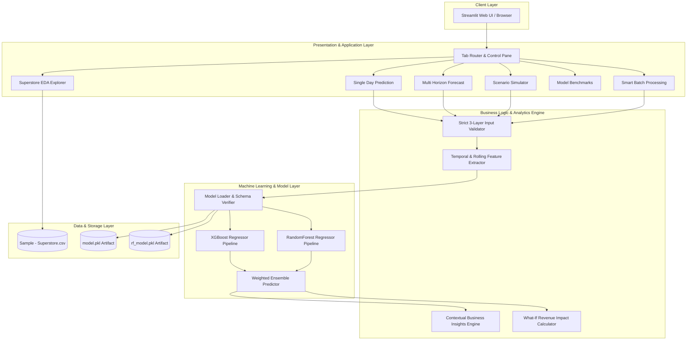
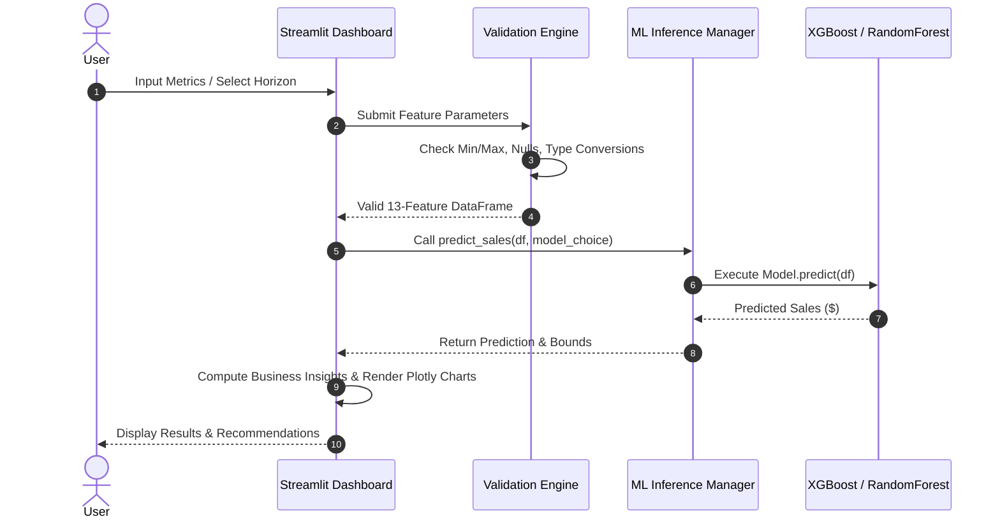

# 🏗️ System Architecture Specification - SalesPulse AI v2.0

## 1. Executive Summary & Overview

**SalesPulse AI v2.0** is an enterprise-grade Machine Learning analytics and decision-support platform designed to transform high-volume time-series retail transaction data into actionable sales forecasts, uncertainty metrics, and strategic scenario planning.

The system utilizes a **decoupled, multi-layered architecture** comprising:
- **Presentation & Interactive Layer:** Streamlit with custom CSS and Plotly graphics.
- **Inference & Model Orchestration Layer:** Dual Model Engine (XGBoost + RandomForest + Ensemble Blend) with load-time schema verification and defensive fallbacks.
- **Feature Engineering & Analytics Engine:** 13-column temporal lag & rolling window pipeline.
- **Persistence & Dataset Ingestion Layer:** Serialized Joblib model artifacts and CSV data pipelines.

---

## 2. High-Level System Architecture Diagram

---

## 3. Layer-by-Layer Architectural Breakdown

### 3.1 Presentation & UI Layer (`app.py`)
- **Technology:** Streamlit 1.30+, Custom CSS, Plotly Express & Graph Objects.
- **Layout:** Responsive 6-tab container interface with an active engine control pane in the sidebar.
- **State Management:** Uses `st.session_state` for preserving forecast horizons, dataframes, and active user inputs across interaction cycles.
- **Themes & Styling:** Custom CSS classes (`.metric-card-v2`, `.badge-v2`, `.insight-card`) configured via `.streamlit/config.toml`.

### 3.2 Machine Learning & Inference Engine
- **Engineered Feature Schema (13 Features):**
  1. `day` – Day of the month (1–31)
  2. `month` – Month of the year (1–12)
  3. `weekday` – Day of the week (0–6)
  4. `is_weekend` – Binary weekend flag (0 or 1)
  5. `weekofyear` – ISO week number (1–53)
  6. `lag_1` – Prior day sales ($)
  7. `lag_7` – 7-day prior sales ($)
  8. `lag_14` – 14-day prior sales ($)
  9. `lag_30` – 30-day prior sales ($)
  10. `rolling_mean_7` – 7-day moving average ($)
  11. `rolling_mean_14` – 14-day moving average ($)
  12. `rolling_std_7` – 7-day rolling standard deviation ($)
  13. `trend` – Sequential trend counter index

- **Models:**
  - **Primary Engine (XGBoost Regressor):** Gradient Boosted Decision Trees trained with `n_estimators=300`, `max_depth=5`, `learning_rate=0.05`.
  - **Alternative Engine (RandomForest Regressor):** Ensemble of 150 decision trees trained with `max_depth=12`.
  - **Ensemble Blend:** $\text{Prediction}_{\text{Ensemble}} = \frac{\text{Prediction}_{\text{XGB}} + \text{Prediction}_{\text{RF}}}{2.0}$.

- **Defensive Fallback & Verification (`load_models()` & `predict_sales()`):**
  - Performs active pre-flight inference checks on startup using a dummy 13-feature DataFrame.
  - Automatically handles model schema mismatches by activating XGBoost fallback to ensure zero runtime crashes.

### 3.3 Multi-Horizon Forecasting Engine
- **Forecast Horizons:** 7-Day, 14-Day, 30-Day horizons.
- **Algorithm:** Iterative auto-regressive loop updating lag and rolling metrics dynamically after each step prediction.
- **Confidence Intervals (95% Prediction Bounds):**
  $$\text{Upper} = y + 1.96 \cdot \max(10.0, \sigma_7) \cdot \sqrt{\frac{i}{2}}$$
  $$\text{Lower} = \max\left(0, y - 1.96 \cdot \max(10.0, \sigma_7) \cdot \sqrt{\frac{i}{2}}\right)$$

### 3.4 Business Scenario Simulator ("What-If" Engine)
- **Mathematical Model:**
  $$\text{Effective Multiplier} = \left(1 + \frac{\text{Promo Boost \%}}{100}\right) \cdot \left(1 + \frac{\text{Price Adjust \%}}{100}\right) \cdot \text{Seasonal Mult}$$
  $$\text{Simulated Sales} = \text{Base Sales} \cdot \text{Effective Multiplier}$$
  $$\Delta \text{Revenue} = \text{Simulated Sales} - \text{Base Sales}$$

### 3.5 Data & Analytics Engine (EDA)
- Ingests `Sample - Superstore.csv` (9,994 sales records).
- Generates interactive Plotly Category Pie Charts, Regional Sales Bar Charts, and transaction KPI metrics.

---

## 4. Component Interaction Diagram

---

## 5. Security & Reliability Controls

| Domain | Control Strategy |
| :--- | :--- |
| **Input Validation** | Strict 3-layer validation preventing NaN, infinity, and out-of-range inputs. |
| **Model Verification** | Startup pre-flight inference test auto-purges incompatible model objects. |
| **Cache Management** | 1-click sidebar cache reset (`st.cache_resource.clear()`) for Streamlit Cloud state reset. |
| **Fault Isolation** | Independent `try-except` wrappers around each individual UI tab. |
