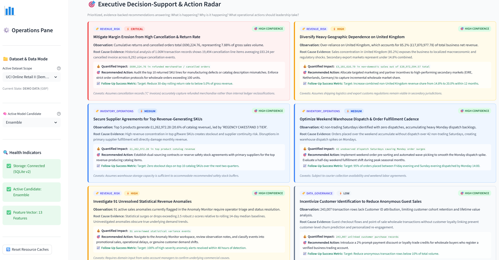
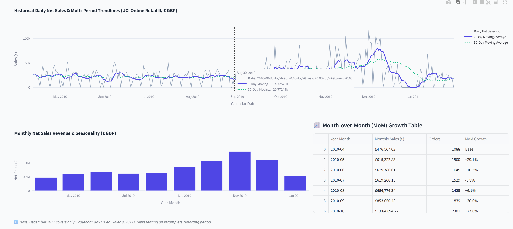
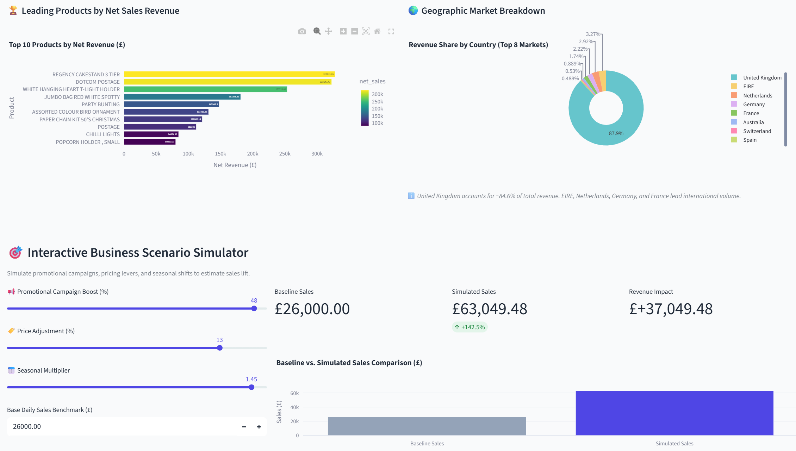
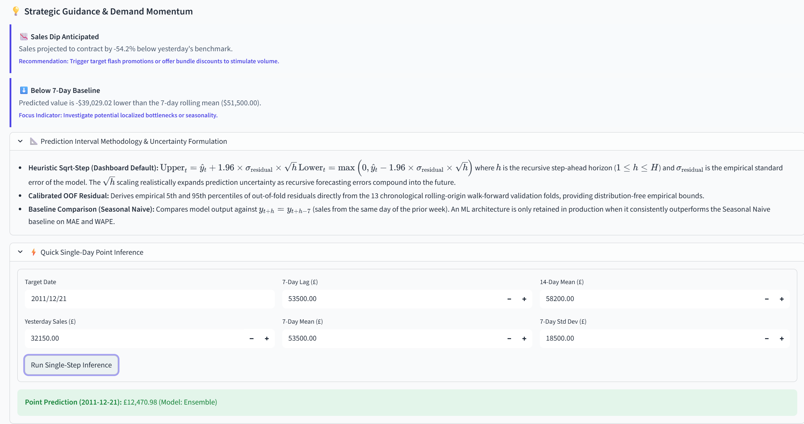
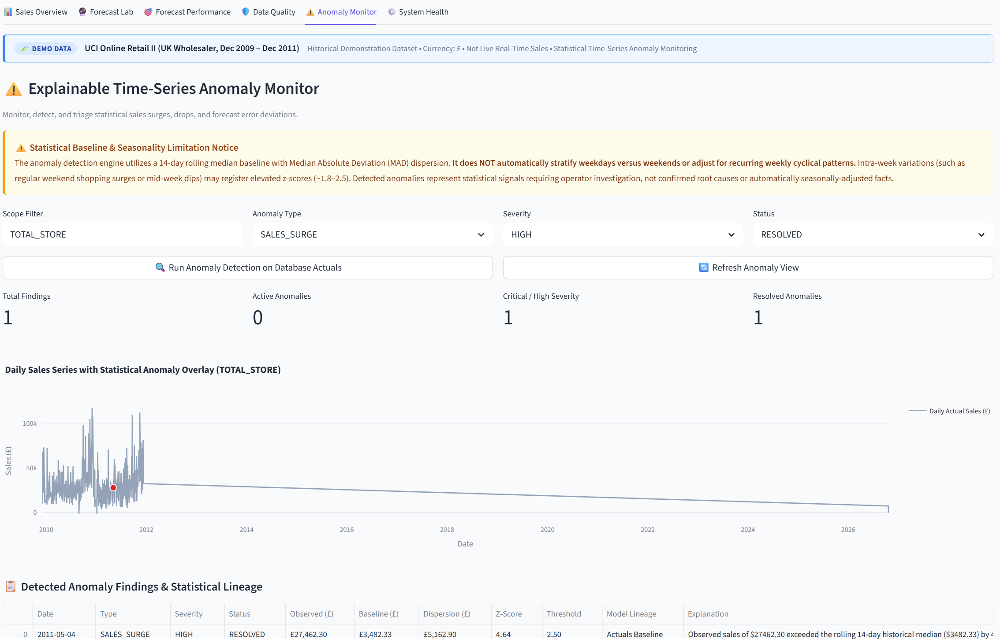

# SalesPulse AI — Operator Dashboard & Feature Walkthrough

**Version:** 3.0.0 (Production Stabilization)
**Target Audience:** Technical Reviewers, Data Engineers, Commercial Planners, MLOps Practitioners
**Companion Documents:** [README](../README.md) • [Integration Contracts](INTEGRATION_CONTRACTS.md) • [Operator Observability Guide](OPERATOR_EXPERIENCE_AND_OBSERVABILITY.md)

---

## 1. Executive Summary & Visual Architecture

SalesPulse AI provides six purpose-built operator workspaces designed to bridge raw commercial transactional data, machine-learning forecasting, statistical anomaly detection, and operational data observability.

```text
┌────────────────────────────────────────────────────────────────────────────────────────┐
│                                   SALESPULSE AI v3.0                                   │
├──────────────────────┬──────────────────────┬──────────────────────────────────────────┤
│ 1. Sales Overview    │ 2. Forecast Lab      │ 3. Forecast Performance & Reconciliation │
│ • Executive KPIs     │ • 7/14/30d Horizons  │ • 13-Origin Walk-Forward CV Benchmarks   │
│ • Trendlines & MoM   │ • Prediction Bands   │ • Ground-Truth Reconciliation Protocol   │
│ • Decision Radar     │ • Run Provenance     │ • Pending Realization Safeguards         │
├──────────────────────┼──────────────────────┼──────────────────────────────────────────┤
│ 4. Data Quality      │ 5. Anomaly Monitor   │ 6. System Health & Governance            │
│ • Ingestion Audit    │ • 14d Rolling Median │ • 4-Dimensional Status Synthesis         │
│ • Contract Checking  │ • MAD Z-Score Filter │ • Verified ML Model Inventory            │
│ • Quarantined Rows   │ • Triage Workflow    │ • Retraining Governance Matrix           │
└──────────────────────┴──────────────────────┴──────────────────────────────────────────┘
```

This guide details each curated screenshot in the `media/` asset library, explaining its operational purpose, observed visual evidence, navigation workflow, and engineering caveats.

---

## 2. Workspace Visual Walkthroughs

> [!NOTE]
> **Runtime Notice & Observability Disclaimer:** All screenshots in this walkthrough are captured examples from specific demonstration runs using the historical UCI Online Retail II dataset. The displayed numbers, date ranges, metrics, and operational statuses illustrate interface capabilities and layout; live values will vary depending on active dataset selection, filtering parameters, SQLite database state, and local runtime execution.

### 2.1 Workspace 1: Sales Overview & Commercial Trajectory

#### Asset: [`media/sales-overview.png`](../media/sales-overview.png)

*Figure 1: Sales Overview Workspace — Captured illustrative run; displayed figures and dates reflect a specific demonstration state and may vary from current runtime.*

- **Purpose:** Primary executive landing view summarizing cumulative sales performance, transaction volume, margin impact, and accounting metrics.
- **Workflow & Navigation:** Select **Sales Overview** from the top workspace navigation tab. Use the date range slider to focus on specific financial quarters.
- **What to Observe:**
  - **Dataset Provenance Badge:** Explicitly cites UCI Machine Learning Repository (Chen, 2012; CC BY 4.0), 1.06M raw records, and continuous calendar span.
  - **Executive Financial KPIs:** Net Realized Revenue (£8,065,744.88 across selected window), Gross Sales (£8,755,969.64), Realized Returns (£690,224.76), Total Orders (16,633), Average Order Value (AOV: £484.92), Average Selling Price (ASP: £1.85), Return Rate (7.88%), and Active Trading Days (239 / 293 days).
  - **Operations Pane (Sidebar):** Confirms active dataset scope (`UCI Online Retail II`), active model candidate (`Ensemble`), and real-time backend health indicators (`Storage: Connected SQLite v2`, `Feature Vector: 13 Features`).
- **Caveats & Nuances:** Filtered dates reflect historical wholesaler transactions. Incomplete calendar periods (such as truncated final reporting months) are noted with contextual disclaimers.

---

### 2.2 Decision Intelligence & Action Radar

#### Asset: [`media/decision-intelligence-radar.png`](../media/decision-intelligence-radar.png)

*Figure 2: Executive Decision Support Radar — Captured illustrative example; displayed directives and impact values may vary from current runtime.*

- **Purpose:** Bridges statistical data observations with prioritized, evidence-backed operational directives for business leadership.
- **Workflow & Navigation:** Located directly beneath the KPI cards on the **Sales Overview** workspace.
- **What to Observe:**
  - **Severity & Category Badging:** Directives are tagged by risk category (`REVENUE_RISK`, `INVENTORY_OPERATIONS`, `DATA_GOVERNANCE`) and urgency (`CRITICAL`, `HIGH`, `MEDIUM`, `LOW`).
  - **Evidence-Backed Directives:**
    1. *Mitigate Margin Erosion from High Cancellation & Return Rate* (Critical): Flags £690,224.76 in refunds across 19,494 cancellation line items, recommending top-10 SKU defect audits.
    2. *Diversify Heavy Geographic Dependence on UK* (High): Highlights 85.2% revenue concentration in the domestic UK market.
    3. *Secure Supplier Agreements for Top SKUs* (Medium): Identifies top 5 products generating £1.26M (20.6% of catalog).
    4. *Optimize Weekend Fulfillment Cadence* (Medium): Addresses Monday order backlogs caused by non-dispatch Saturdays.
    5. *Investigate 91 Statistical Revenue Anomalies* (High): Action item directing operators to the Anomaly Monitor.
    6. *Incentivize Customer Identification* (Low): Targets 243,007 guest checkout rows lacking Customer IDs.
  - **Explicit Directives Structure:** Every recommendation includes Observation, Root-Cause Evidence, Quantified Financial Impact, Recommended Action, Target Follow-Up Metric, and Model Assumptions.
- **Caveats & Nuances:** Recommendations are generated deterministically by the rules engine (`DecisionSupportEngine`) based on verified dataset properties.

---

### 2.3 Time-Series Trendlines & Seasonality

#### Asset: [`media/historical-sales-trendlines.png`](../media/historical-sales-trendlines.png)

*Figure 3: Historical Sales Trendlines & Seasonality — Captured illustrative example; displayed moving averages and daily sales may vary from current runtime.*

- **Purpose:** Detailed inspection of multi-period sales momentum, moving averages, and month-over-month growth patterns.
- **Workflow & Navigation:** Scroll to the middle section of the **Sales Overview** workspace.
- **What to Observe:**
  - **Trendline Decomposition:** Plotly dual-trend visual displaying volatile raw daily net sales (£) paired with a 7-day smoothing average (blue line) and a 30-day baseline trend (green dotted line).
  - **Interactive Hover Tooltip:** Pinpoints specific calendar dates with exact Gross, Net, and Return numbers.
  - **Monthly Seasonality & MoM Growth:** Bar chart showing pre-holiday demand peaks in October/November, accompanied by a clean tabular month-over-month revenue growth breakdown.
- **Caveats & Nuances:** Calendar non-trading dates (Sundays and bank holidays) are explicitly preserved as confirmed £0 trading days to ensure uniform spacing for 7-day lag features.

---

### 2.4 Product Revenue Breakdown & What-If Simulator

#### Asset: [`media/product-revenue-scenario-simulator.png`](../media/product-revenue-scenario-simulator.png)

*Figure 4: Product Revenue Breakdown & What-If Simulator — Captured illustrative example; simulated deltas and catalog rankings may vary from current runtime.*

- **Purpose:** Commercial catalog ranking and interactive simulation of demand elasticity, promotional boosts, and price adjustments.
- **Workflow & Navigation:** Located in the lower third of the **Sales Overview** workspace.
- **What to Observe:**
  - **Top 10 Products by Net Revenue:** Horizontal bar chart colored by net revenue, correctly ranking top catalog items (`REGENCY CAKESTAND 3 TIER`, `DOTCOM POSTAGE`, `WHITE HANGING HEART T-LIGHT HOLDER`).
  - **Geographic Market Share:** Donut chart showing international export volume (EIRE, Netherlands, Germany, France).
  - **Scenario Levers:** Interactive sliders for Promotional Campaign Boost (0–50%), Price Adjustment (-20% to +20%), and Seasonal Multiplier (0.5x to 1.5x).
  - **Instant Delta Realization:** Compares baseline daily sales benchmark (£26,000.00) against simulated revenue (£63,049.48 / +142.5%) with a comparative visual bar chart.
- **Caveats & Nuances:** What-if simulation applies linear elasticity approximations intended for directional planning rather than causal econometric inference.

---

### 2.5 Workspace 2: Production Forecast Lab

#### Asset: [`media/forecast-lab.png`](../media/forecast-lab.png)

*Figure 5: Production Forecast Lab — Captured illustrative example; generated trajectory and prediction intervals may vary from current runtime.*

- **Purpose:** Interactive multi-step forecasting engine allowing operators to generate forward-looking sales trajectories with uncertainty intervals and run provenance.
- **Workflow & Navigation:** Click the **Forecast Lab** tab. Select horizon (7, 14, 30 days), architecture (`Ensemble`), and input feature parameters, then click **Generate Multi-Horizon Forecast**.
- **What to Observe:**
  - **Horizon Controls:** Radio selector for 7-Day, 14-Day, and 30-Day Horizons.
  - **Model Architecture Selector:** Supports `XGBoost`, `RandomForest`, and composite `Ensemble`.
  - **Forecast Provenance Box:** Records immutable Run ID (`UUIDv4`), Origin Date (`2011/12/20`), Scope (`TOTAL_STORE`), Model Architecture, and Horizon.
  - **Uncertainty Bands:** Visual display of forecasted trajectory with expanding prediction uncertainty bounds over the 30-day projection window.
- **Caveats & Nuances:** As horizon $h$ increases, recursive forecasting uncertainty grows proportionally ($\sqrt{h}$), reflecting compounding error variance.

---

### 2.6 Forecast Methodology & Point Inference

#### Asset: [`media/forecast-methodology.png`](../media/forecast-methodology.png)

*Figure 6: Forecast Methodology & Point Inference — Captured illustrative example; point estimates and metric formulas reflect demonstration session inputs.*

- **Purpose:** Transparent documentation of prediction interval mathematics and a lightweight single-step point inference tool for quick operator checks.
- **Workflow & Navigation:** Located below the main forecast chart in the **Forecast Lab** workspace.
- **What to Observe:**
  - **Strategic Demand Momentum Cards:** Automated alerts highlighting projected sales contractions (-54.2% dip below yesterday's benchmark) or drops below 7-day rolling baselines.
  - **Mathematical Formulations:** Displays LaTeX documentation for Heuristic Sqrt-Step intervals ($\text{Upper}_t = \hat{y}_t + 1.96 \cdot \sigma_{\text{residual}} \sqrt{h}$) and Calibrated OOF Residuals.
  - **Quick Point Inference Widget:** Direct inputs for yesterday sales, 7-day lags, and rolling standard deviation returning immediate point estimates (e.g., £12,470.98 for Ensemble).
- **Caveats & Nuances:** Point inference evaluates single-step feature vectors without writing full rollout series to SQLite persistence.

---

### 2.7 Workspace 3: Out-of-Sample Performance Benchmarks

#### Asset: [`media/forecast-performance.png`](../media/forecast-performance.png)

*Figure 7: Out-of-Sample Performance Benchmarks — Captured illustrative example; historical 13-origin walk-forward CV metrics reflect tested benchmark data and may vary across model configurations.*

- **Purpose:** Scientific model evaluation tracking out-of-sample backtesting metrics across 13 chronological rolling origins with strict target embargoes.
- **Workflow & Navigation:** Click the **Forecast Performance** tab and review **Section A: Historical Out-of-Sample Backtesting Performance**.
- **What to Observe:**
  - **Evaluation Integrity Notice:** Explicit notice stating historical backtests measure algorithmic generalizability on past data and do *not* guarantee future realization.
  - **Horizon Dropdown:** Allows switching between 7-day, 14-day, and 30-day cross-validation benchmarks.
  - **Candidate Architecture Comparison Table:** Evaluates Seasonal-Naive Baseline, XGBoost (Dynamic Walk-Forward), RandomForest, and Ensemble across 390 test observations:
    - **MAE ($):** Seasonal-Naive ($2,397.00), XGBoost ($1,847.09), RandomForest ($2,472.75), Ensemble ($2,114.62).
    - **RMSE ($):** Seasonal-Naive ($3,504.26), XGBoost ($2,469.82), Ensemble ($2,691.22).
    - **WAPE (Micro):** XGBoost achieves 73.90% vs. 95.91% for Seasonal-Naive.
    - **Forecast Bias:** Tracks structural overforecasting (+) vs. underforecasting (-).
    - **Interval Coverage:** Validates empirical containment rate (95.1% to 97.2%).
  - **Mathematical Policy Reference:** Expandable panel defining exact metric formulas for MAE, RMSE, WAPE, Bias, and Coverage.
- **Caveats & Nuances:** Benchmarks reflect rigorous chronological cross-validation with zero future-data leakage; naive baseline provides the minimum performance threshold.

---

### 2.8 Ground-Truth Forecast Reconciliation

#### Asset: [`media/forecast-reconciliation.png`](../media/forecast-reconciliation.png)

*Figure 8: Ground-Truth Forecast Reconciliation — Captured illustrative example; realized error metrics and pending realization steps depend on ingested ground truth and active run selection.*

- **Purpose:** Reconciles past persisted forecast runs against newly ingested actual sales recorded in SQLite storage.
- **Workflow & Navigation:** Scroll down to **Section B: Realized Forecast Performance (Reconciled Actuals)** on the **Forecast Performance** workspace. Select a persisted run ID from the dropdown.
- **What to Observe:**
  - **Ground Truth Realization Protocol:** Metrics are computed strictly against matching actuals; unobserved steps are designated **Pending Realization** and never filled with zero.
  - **Realized Performance Metrics:** Realized MAE (£6.12), Realized RMSE (£7.54), Interval Coverage (100.0%), and Realized WAPE (3.65%) over 5 reconciled steps out of 30.
  - **Reconciliation Plot:** Predicted trajectory line, uncertainty envelope, and green diamond markers for observed ground truth.
  - **Step Reconciliation Table:** Itemized breakdown of Target Date, Predicted, Actual, Absolute Error, APE (%), and In Interval confirmation, with steps 6+ clearly showing ⏳ Pending Realization.
- **Caveats & Nuances:** Realized metrics automatically update as new daily sales actuals are recorded in SQLite audit storage.

---

### 2.9 Workspace 4: Data Quality & Ingestion Operations

#### Asset: [`media/data-quality.png`](../media/data-quality.png)

*Figure 9: Data Quality Workspace — Captured illustrative example; audited row counts, checksums, and quarantine stats reflect the ingested dataset.*

- **Purpose:** Ingestion contract enforcement, provenance auditing, calendar coverage validation, and quarantine isolation.
- **Workflow & Navigation:** Click the **Data Quality** workspace tab.
- **What to Observe:**
  - **Official Citation & Checksums:** Direct DOI reference, CC BY 4.0 license, and cryptographic SHA-256 hashes for both the source archive and extracted workbook.
  - **Ingestion Counts:** Source transactions (1,067,371), Accepted rows (1,041,670), Returns / Cancellations (19,494), and Quarantined invalid price adjustments (6,207).
  - **Calendar Coverage Policy:** Date span (2009-12-01 to 2011-12-09 / 739 days), active trading days (604), and confirmed non-trading days (135).
  - **Reconciled Accounting Totals:** Verified Gross Sales (£20,972,594.55), Returns (£1,527,415.00), and Net Realized Sales (£19,445,179.55).
- **Caveats & Nuances:** Quarantined rows (e.g., administrative fee adjustments or missing unit prices) are isolated from forecasting feature tables to prevent model contamination.

---

### 2.10 Workspace 5: Explainable Anomaly Monitor

#### Asset: [`media/anomaly-monitor.png`](../media/anomaly-monitor.png)

*Figure 10: Explainable Anomaly Monitor — Captured illustrative example; detected surges and drops represent statistical signals and may vary based on filter parameters.*

- **Purpose:** Full-spectrum statistical surveillance of the sales series, flagging anomalous surges, drops, and forecast error deviations.
- **Workflow & Navigation:** Click the **Anomaly Monitor** tab. Set filters to `All` to inspect full-time-series findings.
- **What to Observe:**
  - **Statistical Notice Banner:** Discloses that the 14-day rolling median / MAD engine does not automatically stratify recurring weekly cyclical patterns.
  - **Executive Finding Metrics:** Total Findings (93), Active Anomalies (91), Critical / High Severity (38), Resolved Anomalies (2).
  - **Time-Series Anomaly Overlay:** Complete daily sales curve overlaid with red circular markers (statistical surges) and orange downward triangles (severe drops).
- **Caveats & Nuances:** Anomalies represent statistical signals requiring operator investigation, not confirmed root causes or operational faults.

---

### 2.11 Anomaly Triage & Statistical Lineage

#### Asset: [`media/anomaly-monitor-detail.png`](../media/anomaly-monitor-detail.png)

*Figure 11: Anomaly Detail & Triage — Captured illustrative example; displayed z-scores and triage status reflect operator interaction in a demonstration session.*

- **Purpose:** Detailed inspection of individual anomaly findings with full mathematical lineage and operator resolution triage.
- **Workflow & Navigation:** Filter by Anomaly Type (`SALES_SURGE`), Severity (`HIGH`), and Status (`RESOLVED`).
- **What to Observe:**
  - **Filtered Focus:** Displays single isolated surge event on 2011-05-04.
  - **Detected Finding Lineage Table:** Shows Date, Type (`SALES_SURGE`), Severity (`HIGH`), Status (`RESOLVED`), Observed Value (£27,462.30), Rolling Baseline (£3,482.33), Dispersion (£5,162.90), Z-Score (4.64), and Threshold (2.50).
  - **Auditable Explanation:** Plain-language explanation detailing standard deviation exceedance over historical median.
- **Caveats & Nuances:** Operators can toggle status between `ACTIVE` and `RESOLVED` with auditable triage notes persisted to SQLite.

---

### 2.12 Workspace 6: System Health & MLOps Governance

#### Asset: [`media/system-health.png`](../media/system-health.png)

*Figure 12: System Health & MLOps Governance — Captured illustrative example; health cards display truthful 'NOT APPLICABLE' for static demo data and may vary in live ingestion environments.*

- **Purpose:** Operational observability dashboard combining ingestion health contracts, database integrity, model inventory, and retraining governance.
- **Workflow & Navigation:** Click the **System Health** tab.
- **What to Observe:**
  - **4-Dimensional Ingestion SLA Cards:**
    - Data Freshness SLA: Honestly displays `NOT APPLICABLE` with subtitle `Historical Demo: Dec 2011 (Static Archive)` to prevent false green checks.
    - Calendar Staleness: `N/A (STATIC)` covering the 739-day historical span.
    - Ingestion Reliability: `0 FAILURES` (`Latest Outcome: NO_ATTEMPTS`).
    - Dataset Drift Status: `WARNING` (`1 feature warning(s) • Oct 21 11:11`).
  - **Verified ML Model Inventory:** Status of `XGBoost` (`model.pkl`, 720 KB, Verified & Ready), `RandomForest` (`rf_model.pkl`, 11.5 MB, Verified & Ready), and `Ensemble` (`Selected for Inference`).
  - **Persistence & Storage Health:** SQLite schema version `v2`, WAL journal mode active, security safeguard confirmation (zero raw PII or tokens on disk).
  - **MLOps Retraining Governance Matrix:** 3-stage promotion protocol:
    1. *Data Sufficiency Gate:* $\ge 90$ days of newly reconciled actuals required before triggering retraining.
    2. *Degradation vs. Drift:* Verified realized degradation (WAPE shift > 15%) required; drift alone does not trigger retraining.
    3. *Promotion & Rollback:* Champion-Challenger validation with immutable SHA-256 fingerprinting and rollback safeguard.
- **Caveats & Nuances:** In historical demo mode, freshness SLAs are intentionally flagged as non-applicable to maintain absolute reporting integrity.

---

## 3. Image Asset Taxonomy & Inventory

| Curated Filename | Original Source Filename | Format | Dimensions | Size | Primary Documentation Role |
| :--- | :--- | :---: | :---: | :---: | :--- |
| [`sales-overview.png`](../media/sales-overview.png) | `Screenshot 2026-10-22 000705.png` | PNG | 2750 × 1086 | 309 KB | Executive KPI showcase & hero image in README |
| [`decision-intelligence-radar.png`](../media/decision-intelligence-radar.png) | `Screenshot 2026-10-21 235940.png` | PNG | 2744 × 1430 | 717 KB | Action radar & business recommendation engine |
| [`historical-sales-trendlines.png`](../media/historical-sales-trendlines.png) | `Screenshot 2026-10-22 000105.png` | PNG | 2322 × 1038 | 291 KB | Multi-period trendlines, moving averages, MoM growth |
| [`product-revenue-scenario-simulator.png`](../media/product-revenue-scenario-simulator.png) | `Screenshot 2026-10-22 000308.png` | PNG | 2260 × 1282 | 243 KB | Product ranking, country share, what-if simulator |
| [`forecast-lab.png`](../media/forecast-lab.png) | `Screenshot 2026-10-22 000645.png` | PNG | 2304 × 1450 | 241 KB | Multi-horizon forecast generation with uncertainty bands |
| [`forecast-methodology.png`](../media/forecast-methodology.png) | `Screenshot 2026-10-22 000756.png` | PNG | 2270 × 1200 | 245 KB | Uncertainty formulas & single-step point inference |
| [`forecast-performance.png`](../media/forecast-performance.png) | `Screenshot 2026-10-22 000843.png` | PNG | 2302 × 1464 | 409 KB | 13-origin walk-forward CV backtest benchmarks |
| [`forecast-reconciliation.png`](../media/forecast-reconciliation.png) | `Screenshot 2026-10-22 001347.png` | PNG | 2306 × 1434 | 319 KB | Ground-truth realization & pending realization protocol |
| [`data-quality.png`](../media/data-quality.png) | `Screenshot 2026-10-22 001437.png` | PNG | 2030 × 1196 | 323 KB | Dataset provenance, checksums, and row quarantine |
| [`anomaly-monitor.png`](../media/anomaly-monitor.png) | `Screenshot 2026-10-22 001802.png` | PNG | 2284 × 1384 | 265 KB | Full series time-series anomaly detection overview |
| [`anomaly-monitor-detail.png`](../media/anomaly-monitor-detail.png) | `Screenshot 2026-10-22 001634.png` | PNG | 2268 × 1450 | 300 KB | Single anomaly finding triage & statistical lineage |
| [`system-health.png`](../media/system-health.png) | `Screenshot 2026-10-22 001912.png` | PNG | 2280 × 1426 | 388 KB | System health, ingestion SLA, and MLOps governance |

---

## 4. Maintenance Guidelines for Documentation Assets

1. **Immutable Source Preservation:** Raw captured screenshots (`Screenshot YYYY-MM-DD...`) should never be overwritten. New captures should be assigned a distinct timestamp before updating the canonical kebab-case copy.
2. **Deterministic Cropping:** Screenshots should maintain minimum 2000px horizontal resolution to preserve font legibility in table rows and mathematical formulas.
3. **Sensitive Information Auditing:** Before saving captures to `media/`, operators must verify that no local environment paths, database passwords, or private customer records are visible.
