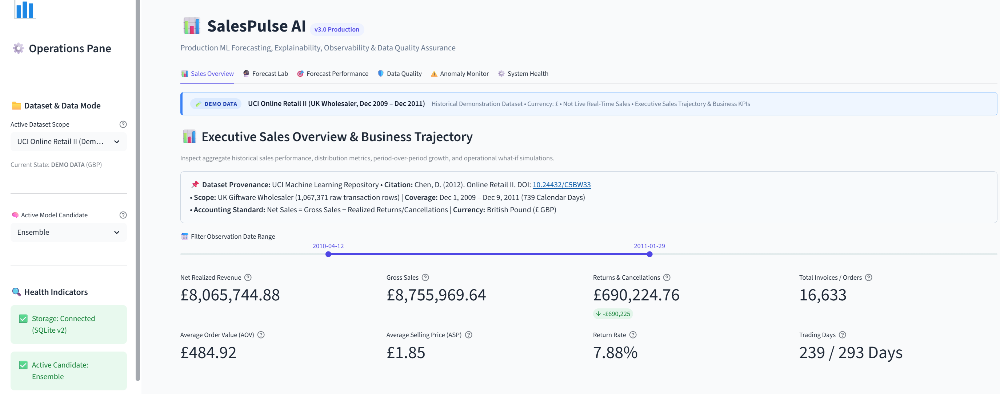
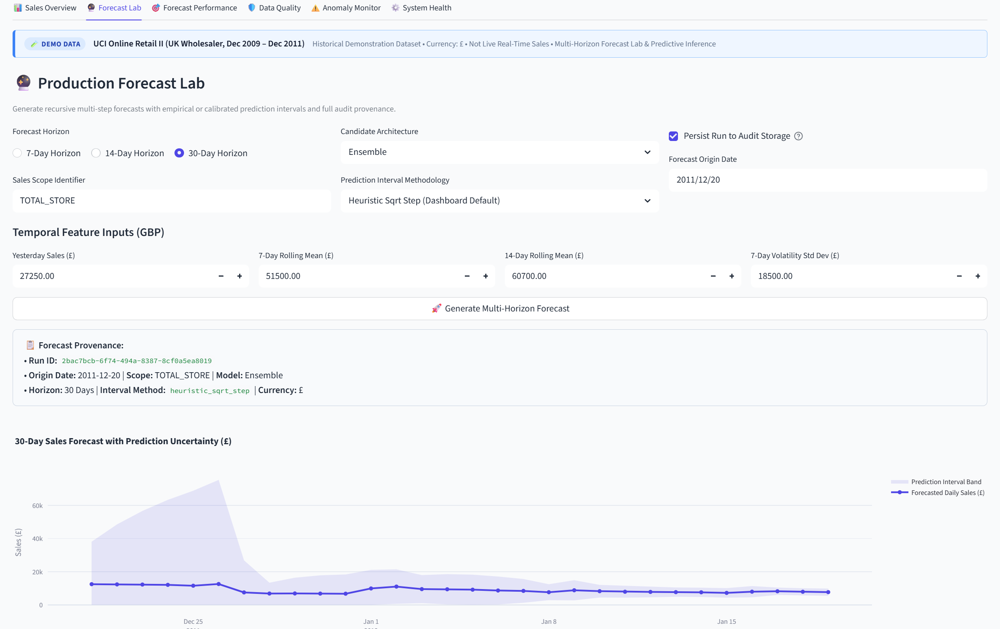
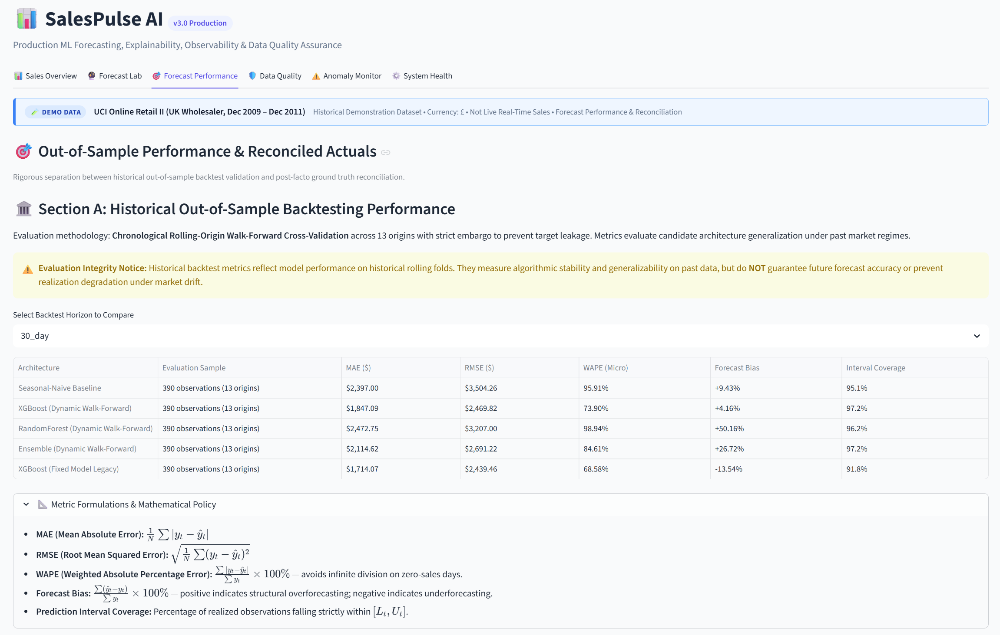
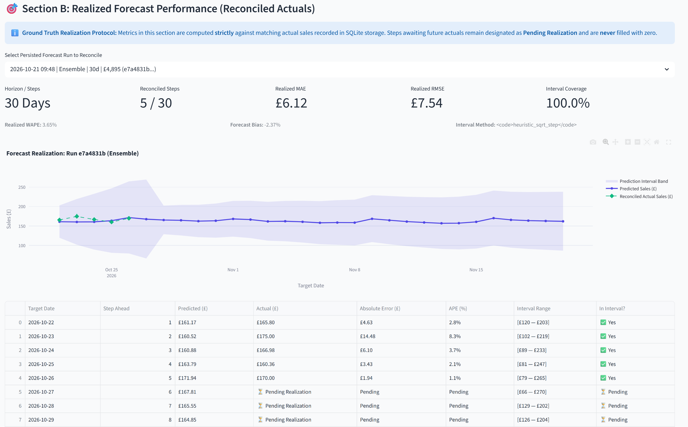
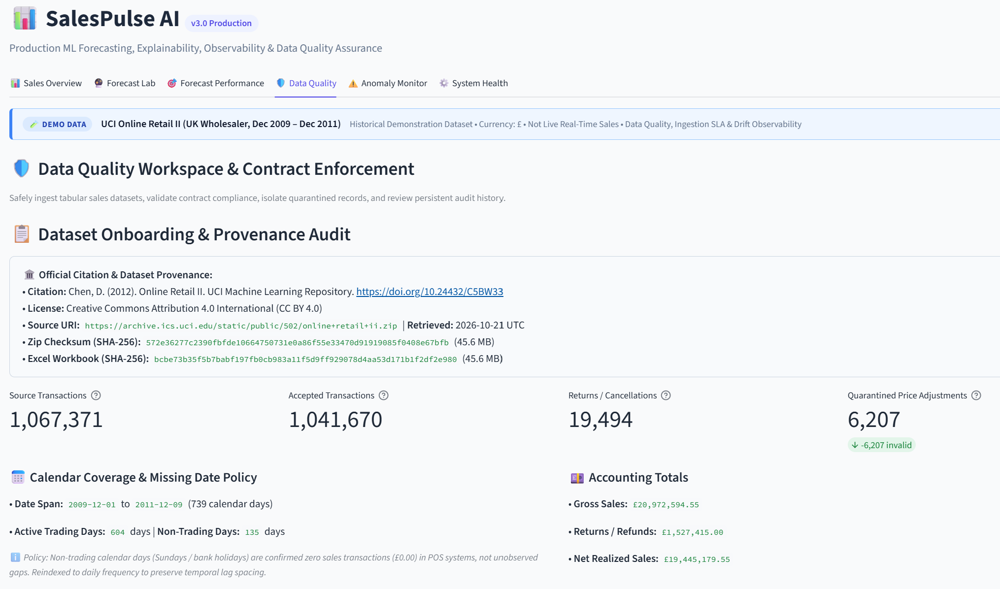
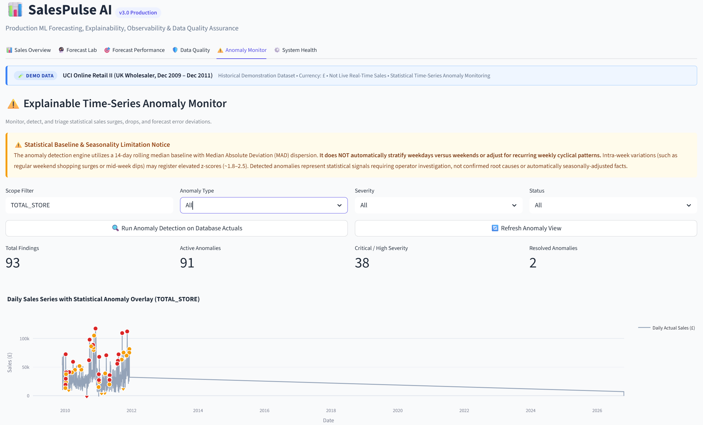
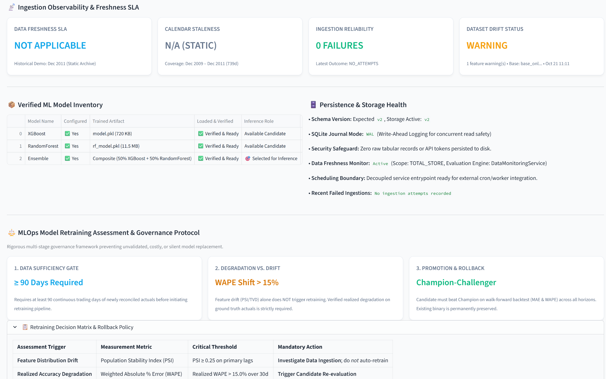

# SalesPulse AI — Operator Experience & ML Observability Guide

## 1. Overview & Operational Philosophy

SalesPulse AI Version 3.0 provides a unified, production-grade ML forecasting, observability, and data quality dashboard built on Streamlit.

The operator experience is structured around 6 dedicated workspaces:
1. **Sales Overview:** Executive business KPIs, historical daily trends, and interactive business "What-If" scenario simulation.
2. **Forecast Lab:** Multi-horizon recursive forecasting (7, 14, 30 days) with candidate model selection, empirical or calibrated prediction interval methods, and persistent audit logging with run ID provenance.
3. **Forecast Performance:** Out-of-sample realization tracking comparing historical forecast runs against reconciled ground-truth actuals, calculating MAE, RMSE, WAPE, Bias, and Interval Coverage.
4. **Data Quality:** Ingestion verification enforcing data contracts, isolating quarantined records, and maintaining an immutable persistent audit trail (`DatasetAuditLog`) with zero customer PII retention.
5. **Anomaly Monitor:** Explainable statistical time-series anomaly detection with scope, type, severity, and status filtering, overlay visualization, evidence cards, and operator triage resolution workflows.
6. **System Health:** Operational readiness diagnostics covering SQLite WAL database status, schema version verification (`v2`), model registry candidate inventory, and cache management.

### 1.1 Canonical Live Application & Operational Context

The complete Version 3.0 operator interface is deployed live at:
👉 **[https://salespulseai.streamlit.app/](https://salespulseai.streamlit.app/)**

> [!IMPORTANT]
> **Hosted Demo vs. Enterprise Operator Boundaries:**
> - **Public Sandbox Environment:** The hosted deployment at [`https://salespulseai.streamlit.app/`](https://salespulseai.streamlit.app/) provides an interactive demonstration of all six workspaces using pre-loaded baseline datasets (UCI Online Retail II and US Superstore).
> - **Decoupled Service Topology:** Accessing the Streamlit frontend does **not** imply that an external FastAPI service is publicly deployed. The hosted Streamlit application operates in self-contained local domain mode; the headless REST API (`salespulse.api.app`) is designed for local workstations or dedicated private VPC deployments.
> - **State & Persistence Lifecycles:** On Streamlit Community Cloud, container disks are ephemeral. Uploaded files, custom triage notes, and persisted forecast runs stored in the local SQLite database reset upon container reboots. Enterprise deployments require persistent storage volumes or an external PostgreSQL instance.
> - **Ingestion Health Integrity Policy:** In demo mode where a historical static archive is loaded, the Freshness SLA truthfully reports `NOT APPLICABLE (HISTORICAL DEMO ARCHIVE)`. An absence of ingestion history or lack of failure records must **never** be misdiagnosed or presented as positive proof of a healthy pipeline.

---

## 2. Workspace Navigation & Workflows

> [!NOTE]
> **Runtime Notice:** Workspace previews below illustrate captured system states during demonstration testing with the UCI Online Retail II dataset. Displayed figures, dates, metrics, and health statuses reflect specific recorded sessions and may differ across active runs, uploaded datasets, or local runtime environments.

### 2.1 Sales Overview Workspace

[](../media/sales-overview.png)
*Figure 2.1: Sales Overview — Captured illustrative run; displayed figures and dates reflect a demonstration state and may vary at live runtime.*

- **Executive KPIs:** Live summaries of Total Realized Revenue, Transaction Volume, Average Order Value (AOV), and Top Product Category.
- **Continuous Daily Trend:** Time-series plot of reindexed daily sales paired with a 7-day rolling moving average.
- **Business Scenario Simulator:** Operator levers for Promotional Campaign Boost (0–50%), Price Adjustment (-20% to +20%), and Seasonal Multiplier (0.5x to 1.5x), delivering instant revenue impact deltas and baseline comparisons.
- **Model Benchmarks & Explainability:** Expandable walk-forward rolling-origin cross-validation metrics matrix and XGBoost feature importance rankings.

### 2.2 Forecast Lab Workspace

[](../media/forecast-lab.png)
*Figure 2.2: Forecast Lab — Captured illustrative run; generated trajectory and prediction intervals reflect demonstration inputs.*

- **Workflow:**
  1. Select Forecast Horizon (7, 14, or 30 days).
  2. Select Active Candidate Model (`XGBoost`, `RandomForest`, or `Ensemble`).
  3. Select Prediction Interval Method: `heuristic_sqrt_step` (legacy empirical square-root horizon expansion) or `calibrated_oof_residual` (calibrated out-of-fold residual bounds).
  4. Specify Sales Scope (`TOTAL_STORE` or custom identifier).
  5. Check `Persist Run to Audit Storage` to enable delayed realization tracking.
  6. Adjust temporal feature inputs or use pre-populated recent lag values.
  7. Click `Generate Multi-Horizon Forecast`.
- **Output:**
  - Provenance Banner with unique Run ID (`UUIDv4`), origin timestamp, scope, model, and interval method.
  - Interactive Plotly chart with prediction interval uncertainty band.
  - Formatted data table and instant CSV download button.
  - Actionable business recommendations (demand trajectory and 7-day moving average momentum).

### 2.3 Forecast Performance Workspace

[](../media/forecast-performance.png)
*Figure 2.3a: Forecast Performance Benchmarks — Captured illustrative run; 13-origin CV benchmarks reflect tested historical data and do not guarantee future performance.*

[](../media/forecast-reconciliation.png)
*Figure 2.3b: Ground-Truth Forecast Reconciliation — Captured illustrative run; realized metrics reflect matching actuals and pending realization guards.*

- **Delayed Realization Protocol:**
  - Forecast items remain in state `Pending Realization (Awaiting Actuals)` until corresponding ground-truth actual sales are ingested.
  - **Missing actuals are NEVER treated as zero.** They are excluded from error calculations to prevent artificial distortion of MAE, RMSE, WAPE, or Bias.
  - **No Historical Guarantee:** Historical evaluation metrics reflect realized past accuracy and do not guarantee future performance.
- **Metrics Calculated:**
  - **MAE (Mean Absolute Error):** $\frac{1}{N} \sum |actual - predicted|$ across realized steps.
  - **RMSE (Root Mean Squared Error):** $\sqrt{\frac{1}{N} \sum (actual - predicted)^2}$ across realized steps.
  - **WAPE (Weighted Absolute Percentage Error):** $\frac{\sum |actual - predicted|}{\sum actual} \times 100\%$.
  - **Mean Bias (%):** $\frac{\sum (predicted - actual)}{\sum actual} \times 100\%$.
  - **Interval Coverage Rate (%):** Percentage of realized steps where $lower\_bound \le actual \le upper\_bound$.
- **Operator Actuals Tool:** Form to ingest actual daily sales for a calendar date, automatically triggering cross-run reconciliation for all matching forecast items.

### 2.4 Data Quality Workspace

[](../media/data-quality.png)
*Figure 2.4: Data Quality Workspace — Captured illustrative run; audited row counts and checksums reflect the ingested dataset.*

- **Ingestion Protocol:** Accepts CSV or Excel tabular records. Safe ingestion automatically detects dataset grain (`TRANSACTION`, `DAILY_AGGREGATED`, `FEATURE_BATCH`).
- **Data Freshness & Ingestion Monitoring (Phase 4A & 4A.1 Reliability Hardening):**
  - **Trustworthy Signals:** Evaluates last successful ingestion timestamp, latest attempt outcome, calendar observation freshness (staleness vs threshold), validation failure/warning counts, consecutive failure escalations, and historical reliability rate.
  - **Cadence-Aware Freshness SLAs:** Configurable per dataset scope (`HOURLY`, `DAILY`, `WEEKLY`, `MONTHLY`, `CUSTOM`) with deterministic UTC reference date handling.
  - **Zero Sales vs Missing Data:** Legitimate zero-sales trading dates (`daily_sales == 0.0`) are treated as valid observations and never misdiagnosed as missing data or gap anomalies.
  - **Deterministic Status Precedence Policy:**
    1. **`UNKNOWN`:** Database offline, telemetry missing, or uninitialized observation baseline with no ingestion history.
    2. **`CRITICAL`:** Recurring failures ($\ge 2$ consecutive), most recent ingestion `FAILED`, or severe staleness ($> \text{critical staleness multiplier} \times \text{threshold}$).
    3. **`WARNING`:** Moderate staleness ($> \text{threshold}$ days for configured cadence), most recent ingestion outcome `WARNING`, or active validation flags.
    4. **`HEALTHY`:** Strictly when all required signals pass, data is fresh within cadence SLA, zero consecutive failures, and latest attempt passed.
  - **Current Health vs. Historical Reliability:** A successful ingestion attempt resets consecutive failures and restores current health to `HEALTHY`, but does NOT erase historical failures. The historical reliability rate (e.g. `100.0% (10/10)`) preserves long-term pipeline observability across the lookback window.
  - **Privacy-Safe Audit Storage:** Sanitizes file paths to basenames and never records raw customer tabular rows, PII, credentials, or sensitive payloads in evidence JSON.
  - **Operator Action:** Manual "🔄 Run Check" evaluates live health on-demand without expensive background executions during regular UI reruns.
  - **Dual State Visibility:** Separately displays the live on-demand check results and the latest persisted storage snapshot with their respective UTC timestamps.
  - **Audit History:** Expandable log displaying historical monitoring check records, status transitions, and actionable remediations.
- **Contract Enforcement:**
  - `PASSED`: All contracts met; records ready for downstream forecasting.
  - `WARNING`: Non-blocking review flags (e.g. freshness staleness, non-critical distribution anomalies).
  - `FAILED`: Critical violations (duplicate daily keys, invalid numeric sales, missing required feature columns); downstream forecasting is blocked.
- **Quarantine Isolation:** Defective rows are segregated into quarantine with sample row indices and actionable remediation advice.
- **Audit History:** Live table of recent validation runs querying `DatasetAuditLog`. Never stores raw tabular rows.

### 2.5 Anomaly Monitor Workspace

[](../media/anomaly-monitor.png)
*Figure 2.5: Explainable Anomaly Monitor — Captured illustrative run; detected statistical anomalies reflect demonstration filters.*

- **Statistical Detection Methodology:**
  - Baseline Center: 14-day rolling median ($C_t = \text{median}(S_{t-W}, \dots, S_{t-1})$).
  - Dispersion Scale: Scaled Median Absolute Deviation ($\text{MAD} \times 1.4826$), falling back to IQR scale or deterministic minimum if dispersion is zero.
  - Robust Z-Score: $z_t = \frac{x_t - C_t}{\text{scale}}$.
  - Classification:
    - `SALES_SURGE`: $z_t \ge k_{surge}$ ($+2.5$).
    - `SALES_DROP`: $z_t \le -k_{drop}$ ($-2.5$).
    - `FORECAST_ERROR_ANOMALY`: Extreme realized forecast error.
  - Severity Levels:
    - `LOW`: $2.0 \le |z| < 2.5$
    - `MEDIUM`: $2.5 \le |z| < 3.5$
    - `HIGH`: $3.5 \le |z| < 5.0$
    - `CRITICAL`: $|z| \ge 5.0$
- **SEASONALITY LIMITATION NOTICE:**
  > **Important Operator Notice:** The 14-day rolling median baseline pools weekdays and weekends together without day-of-week stratification. Expected intra-week cyclical variations (e.g. Saturday retail surges or mid-week lulls) may register elevated z-scores (~1.8–2.5). Detected anomalies represent statistical signals for operational investigation, not confirmed root causes or automatically seasonally-adjusted facts.
- **Operator Triage Workflow:** Operators can select any active anomaly, supply an operational rationale (e.g. "Confirmed flash promotion" or "Warehouse power failure"), and mark the anomaly as `RESOLVED`. The audit log records the resolution timestamp and rationale immutably.

### 2.6 System Health Workspace

[](../media/system-health.png)
*Figure 2.6: System Health Workspace — Captured illustrative run; displays truthful 'NOT APPLICABLE' for static demo data and may vary in live environments.*

- **Diagnostic Probes:**
  - **Database Readiness:** Checks SQLite WAL connection and verifies active schema version matches application `SCHEMA_VERSION=2`.
  - **Data Freshness & Ingestion SLA:** Displays overall status, calendar staleness days relative to SLA, consecutive failures, and scheduling readiness.
  - **Candidate Registry:** Enumerates active ML models (`XGBoost`, `RandomForest`, `Ensemble`).
  - **Service Architecture:** Probes optional FastAPI daemon (`http://127.0.0.1:8000/ready`). When offline, confirms local self-contained domain mode is operating independently.
  - **Persistence Inventory:** Live counts of persisted forecast runs, anomalies, validation logs, and monitoring checks.
  - **Resource Caches:** Purges `@st.cache_resource` and `@st.cache_data` on demand.

### E. Dataset Drift Monitoring (Phase 4B)
Located in the **Data Quality Workspace (`tab_quality`)**, this layer provides explainable statistical surveillance over input distributions without retraining models or leaking sensitive customer rows.
- **Reference Baselines:**
  - Versioned baseline profiles (`DriftBaselineProfile`) storing deterministic summary statistics, quantile/histogram bin edges, and category proportions.
  - Baseline promotion is explicit; creating a new baseline never silently replaces the active reference baseline during monitoring.
  - Strict privacy: only aggregated statistics and RFC 8259 JSON profiles are persisted; raw customer rows are never stored.
- **Explainable Metrics & Safeguards:**
  - **Numeric Continuous Features:** Evaluated using the **Population Stability Index (PSI)**.
    - $PSI < 0.10$: `NO_DRIFT` (stable distribution).
    - $0.10 \le PSI < 0.25$: `WARNING` (moderate shift warranting monitoring).
    - $PSI \ge 0.25$: `DRIFT` (significant divergence).
    - Safeguards: Laplace / epsilon smoothing ($\epsilon = 10^{-4}$) to prevent $\ln(0)$ or division-by-zero errors. Features with zero standard deviation (constant in baseline) are checked for deviation without numerical overflow.
  - **Categorical Features:** Evaluated using **Total Variation Distance (TVD)** and **Unseen Category Tracking**.
    - $TVD = \frac{1}{2} \sum |P_{baseline}(c) - P_{current}(c)|$.
    - Unseen categories exceeding 5% volume or $TVD \ge 0.25 \rightarrow$ `DRIFT`.
  - **Data Quality & Schema Checks:** Missing baseline columns trigger critical `SCHEMA_CHANGE` drift; shifts in null rates $\ge 15\%$ elevate warnings.
  - **Insufficient Data Safeguard:** If baseline or current sample size is $< 30$ rows, status is reported as `UNKNOWN` with actionable explanation, never falsely as `NO_DRIFT`.
  - **Sales Calendar Context:** Temporal coverage and weekend proportions are evaluated to help operators distinguish genuine distribution shifts from intra-week calendar cycles.

---

## 3. Local Startup & Execution Instructions

### Running Streamlit Locally
```powershell
# In project root
streamlit run app.py
```
The application executes natively using local domain services (`ForecastingService`, `ValidationService`, `AnalyticsService`, `DataMonitoringService`, `DatasetDriftService`, `AuditRepository`, `ModelRegistry`). A running FastAPI server is **not required**.

### Running Optional FastAPI Daemon
```powershell
uvicorn salespulse.api.app:app --host 127.0.0.1 --port 8000 --reload
```

### Scheduling Boundary & Background Workers
The monitoring service is deliberately decoupled from Streamlit reruns. In Phase 4A & 4B, no background daemon is spawned by the frontend. Instead, external schedulers (e.g., cron, Airflow DAG, systemd timer) invoke programmatic entrypoints on a defined cadence.

### Running Test Suites
```powershell
# Run dataset drift monitoring tests
pytest tests/test_drift.py -v

# Run data freshness and ingestion monitoring tests
pytest tests/test_monitoring.py -v

# Run storage persistence and migration tests
pytest tests/test_storage.py -v

# Run dashboard integration tests
pytest tests/test_dashboard.py -v

# Run full project regression test suite (162 tests)
pytest -v

# Verify compilation
python -m py_compile app.py salespulse/monitoring/drift_service.py salespulse/monitoring/drift_schemas.py
```

---

## 4. Known Limitations & Deferred Capabilities

1. **Continuous Scheduler Daemon:** Phase 4A/4B establishes decoupled monitoring services and cron-ready entrypoints, but deliberately avoids launching uncontrolled always-running background threads inside Streamlit. An external orchestrator or background worker process will be introduced when production deployment infrastructure is finalized.
2. **Automated Model Retraining:** In accordance with platform governance, drift alerts provide actionable recommendations for operators; automatic retraining loops are deliberately not triggered without human sign-off.
3. **Multi-Tenant Permissions:** Role-based access control (RBAC) and user authentication are deferred; all operators currently share administrative visibility.

